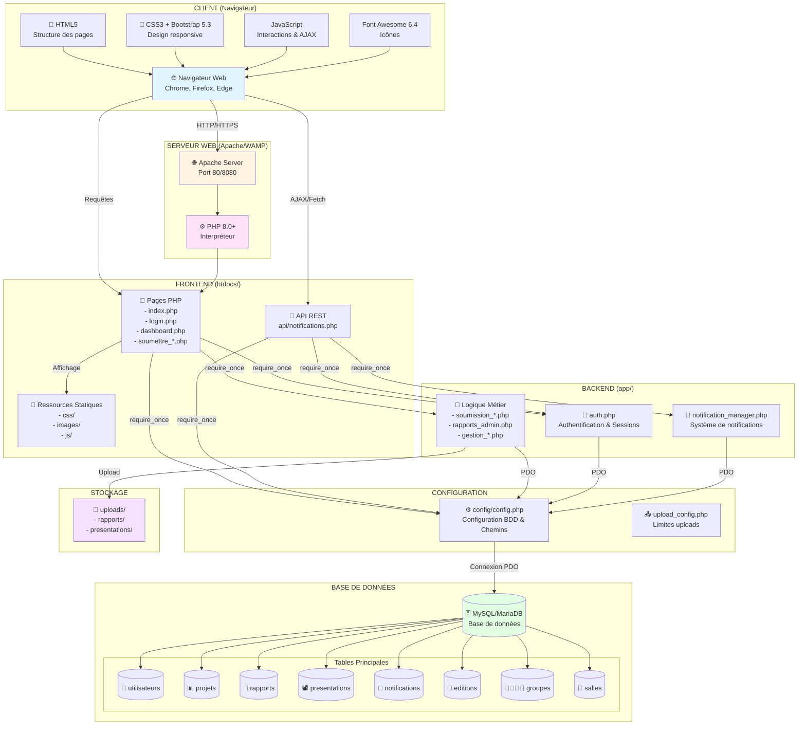
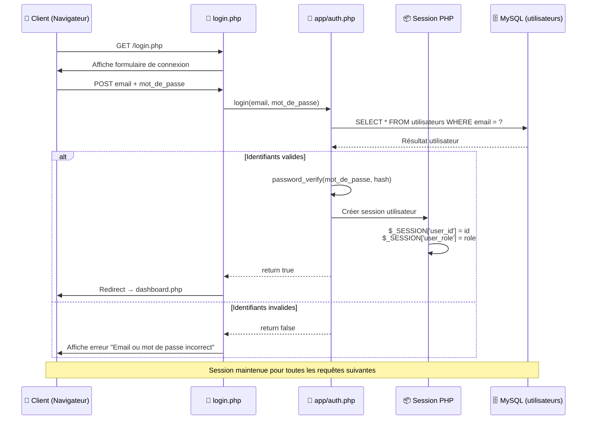
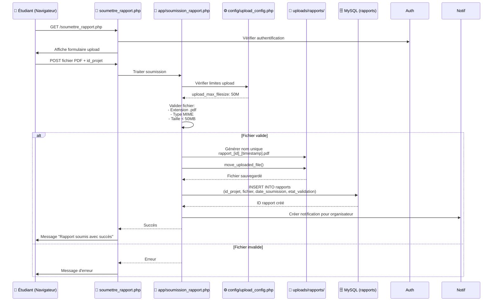
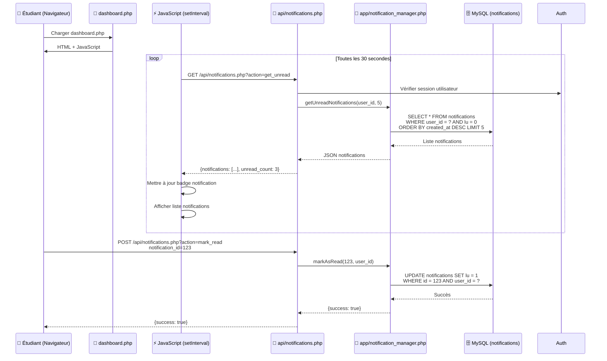
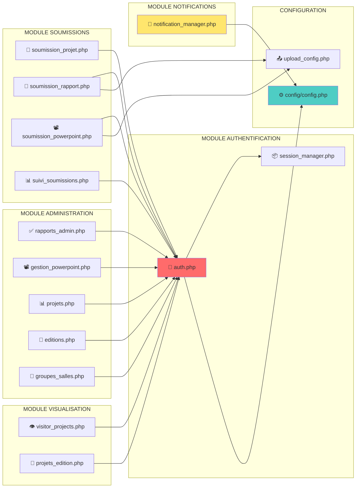
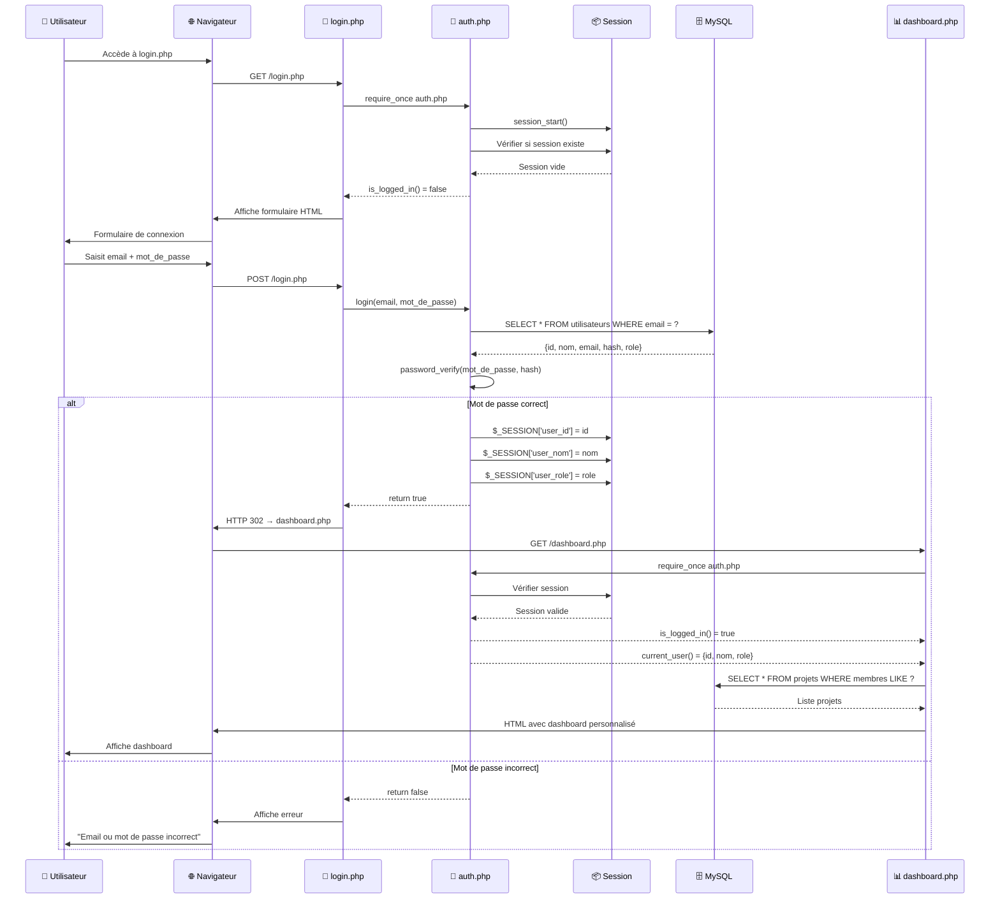
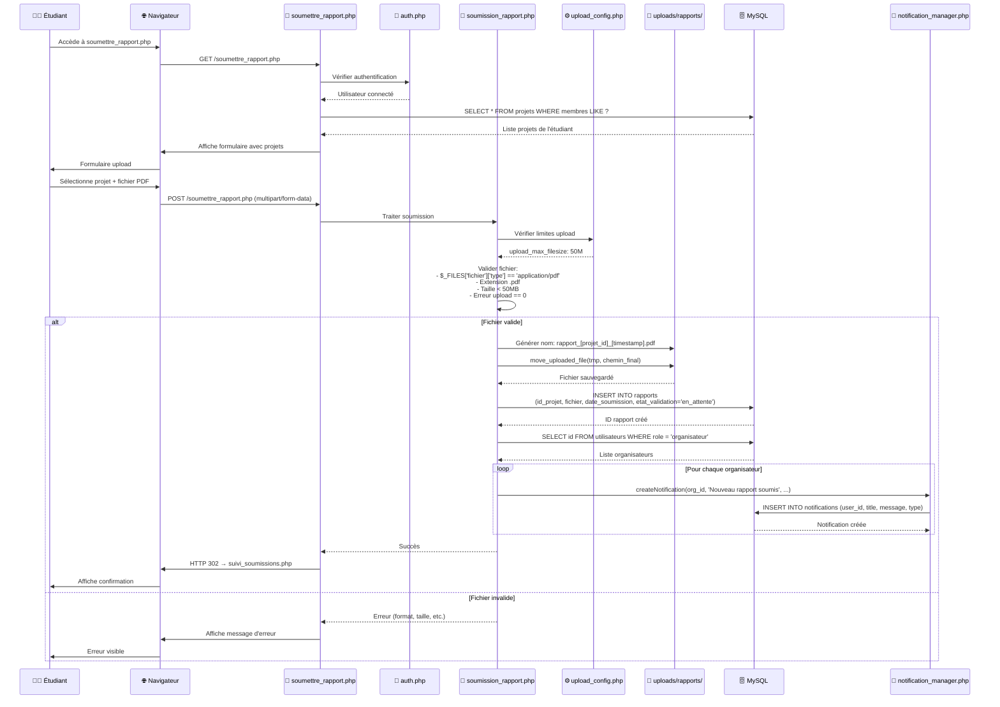
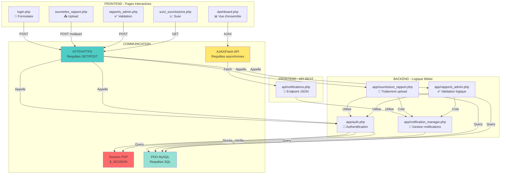
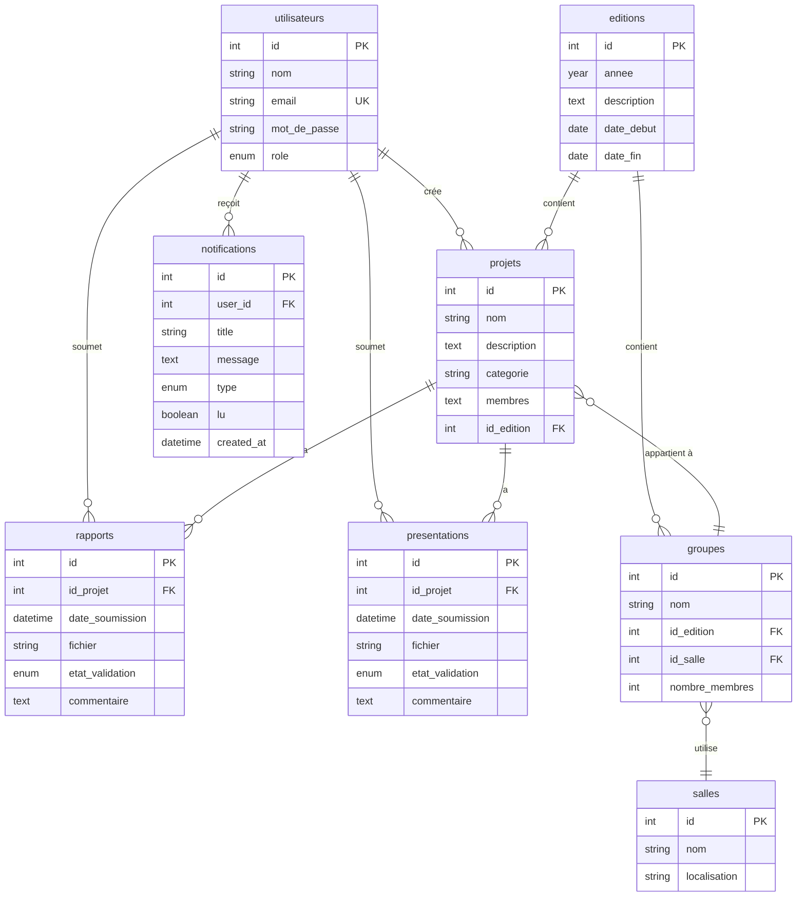
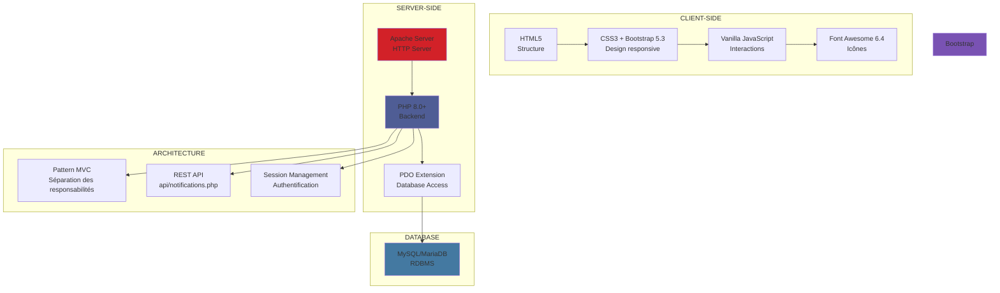

# 🏗️ Architecture Client-Serveur - Plateforme SEIC LBS

## 📋 Table des Matières
1. [Architecture Globale](#architecture-globale)
2. [Flux de Données - Authentification](#flux-dauthentification)
3. [Flux de Données - Upload de Fichiers](#flux-upload-fichiers)
4. [Flux de Données - Notifications Temps Réel](#flux-notifications)
5. [Structure des Modules Backend](#structure-modules)
6. [Diagramme de Séquence - Connexion](#sequence-connexion)
7. [Diagramme de Séquence - Soumission Rapport](#sequence-soumission)

---

## 🎯 Architecture Globale

---

## 🔐 Flux d'Authentification

---

## 📤 Flux Upload de Fichiers (Rapport PDF)

---

## 🔔 Flux Notifications Temps Réel

---

## 🏛️ Structure des Modules Backend

---

## 🔄 Diagramme de Séquence - Connexion Complète

---

## 📊 Diagramme de Séquence - Soumission Rapport

---

## 🔗 Interactions Frontend-Backend

---

## 📦 Structure des Données

---

## 🎨 Stack Technologique

---

## 📝 Notes Importantes

### 🔒 Sécurité
- **Sessions sécurisées** : Régénération d'ID de session
- **Requêtes préparées** : Protection contre injection SQL
- **Validation des fichiers** : Vérification extension + type MIME
- **Authentification requise** : Vérification sur chaque page protégée

### ⚡ Performance
- **PDO avec requêtes préparées** : Optimisation des requêtes SQL
- **Index sur les tables** : Amélioration des performances
- **CDN pour Bootstrap/Font Awesome** : Chargement rapide des ressources

### 📱 Responsive Design
- **Bootstrap 5.3** : Grille responsive
- **Media queries** : Adaptation mobile/tablette/desktop
- **Design mobile-first** : Optimisé pour petits écrans

---

**Auteur** : Khalil  
**Version** : 1.0  
**Date** : 2025

