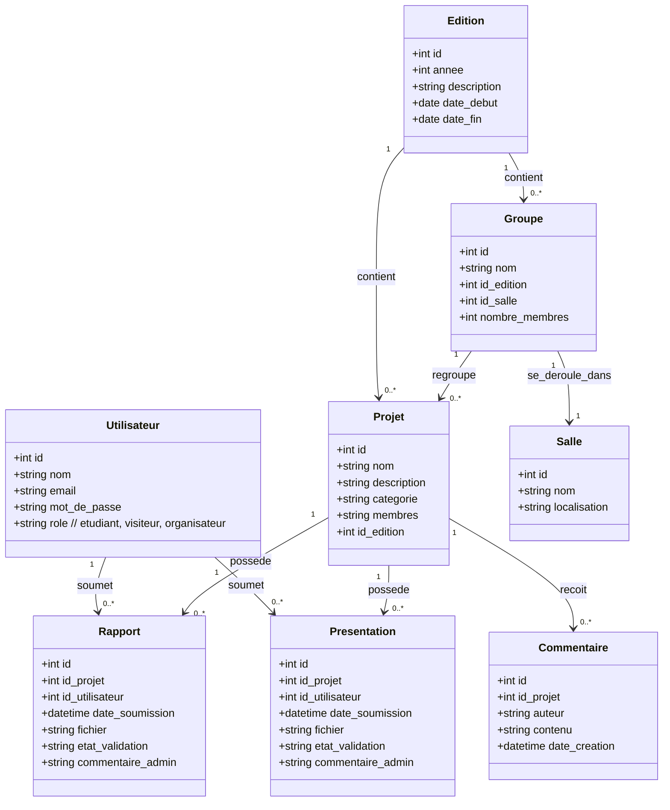
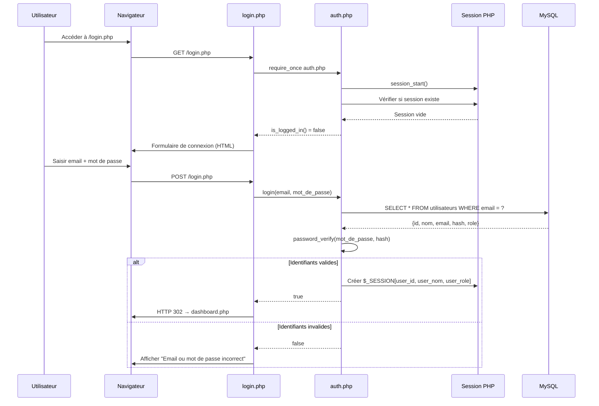
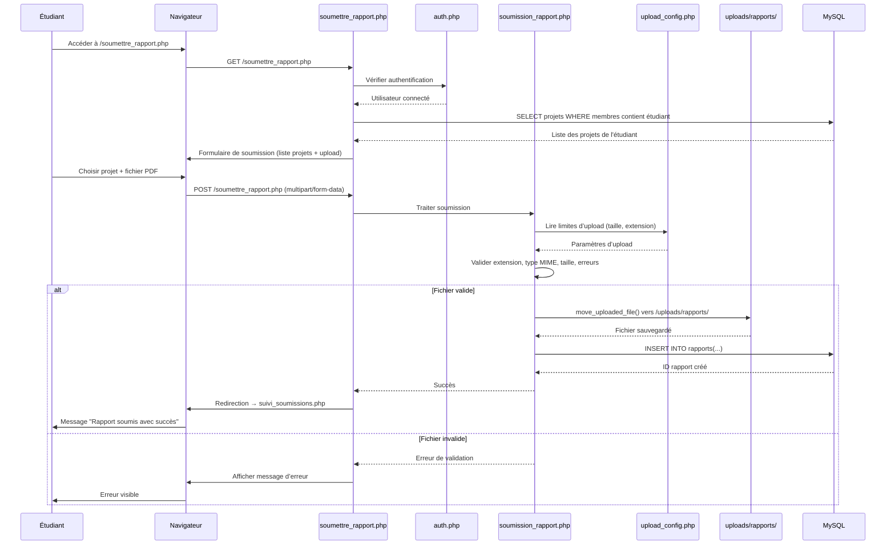
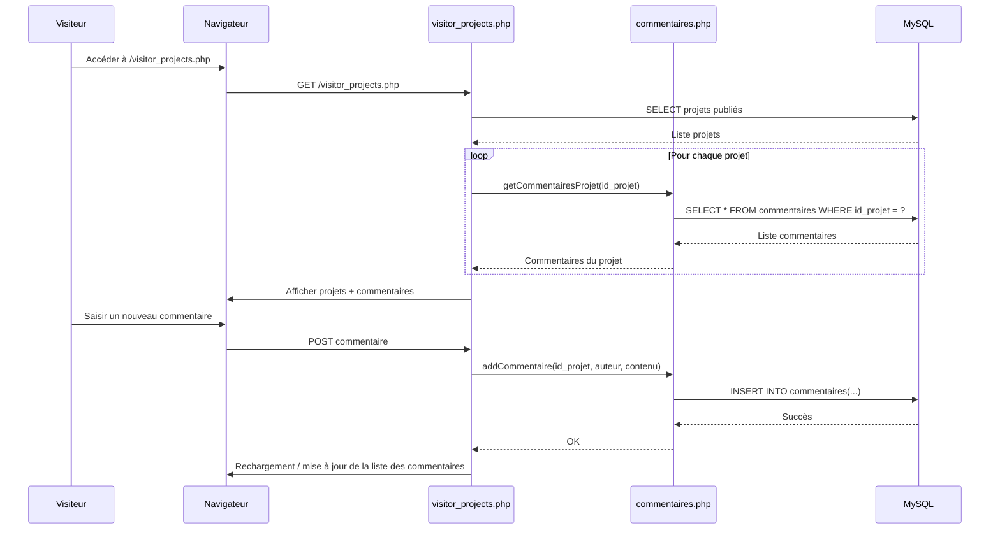
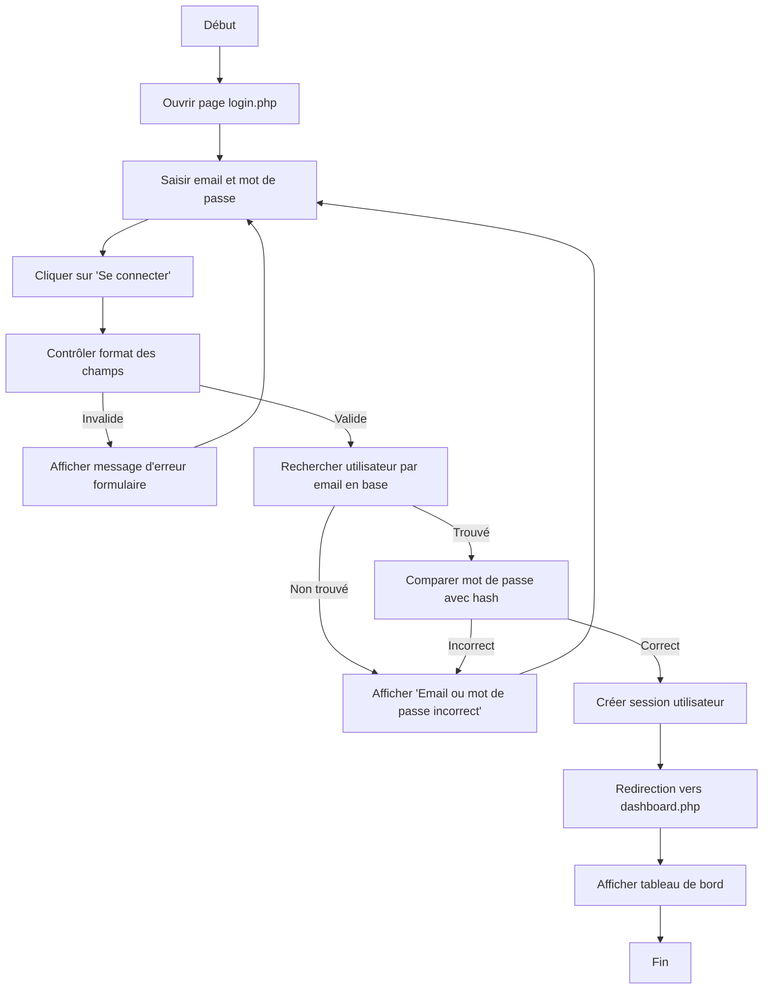
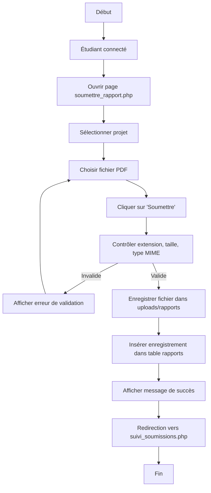

## Chapitre X – Diagrammes UML de la plateforme SEIC LBS

Ce document regroupe les principaux diagrammes UML utilisés dans le mémoire pour décrire la plateforme SEIC LBS : diagramme de classes, diagrammes de séquence, diagrammes d’activités et diagramme de déploiement.

---

## 1. Diagramme de classes

Le diagramme de classes ci‑dessous présente la structure statique du système SEIC LBS.  
Il met en évidence les principales entités (utilisateurs, projets, rapports, présentations, commentaires, etc.), leurs attributs ainsi que les relations entre elles (soumission, appartenance à une édition, regroupement en groupes, utilisation de salles).



**Figure X.1 : Diagramme de classes du système SEIC LBS**

---

## 2. Diagrammes de séquence

### 2.1 Diagramme de séquence – Connexion d’un utilisateur

Ce diagramme de séquence illustre le scénario de connexion d’un utilisateur à la plateforme SEIC LBS.  
Il montre les interactions entre l’acteur « Utilisateur » et les objets du système (navigateur, page `login.php`, module d’authentification, session, base de données) depuis l’affichage du formulaire de connexion jusqu’à l’accès au tableau de bord ou l’affichage d’un message d’erreur.



**Figure X.2 : Diagramme de séquence – Connexion d’un utilisateur**

---

### 2.2 Diagramme de séquence – Soumission d’un rapport

Ce diagramme de séquence décrit le scénario de soumission d’un rapport PDF par un étudiant.  
Il détaille l’enchaînement des messages entre l’étudiant, l’interface web, la logique métier de soumission, la configuration d’upload, le système de fichiers et la base de données, depuis le choix du projet et du fichier jusqu’à la confirmation de succès ou le message d’erreur.



**Figure X.3 : Diagramme de séquence – Soumission d’un rapport**

---

### 2.3 Diagramme de séquence – Consultation des projets et commentaires (visiteur)

Ce diagramme de séquence représente la consultation des projets par un visiteur ainsi que l’ajout de commentaires.  
Il met en évidence l’interaction entre l’acteur « Visiteur » et les composants `visitor_projects.php`, le module de commentaires et la base de données pour l’affichage et l’enregistrement des commentaires.



**Figure X.4 : Diagramme de séquence – Consultation des projets et commentaires**

---

## 3. Diagrammes d’activités

### 3.1 Activité : Connexion d’un utilisateur

Le diagramme d’activités suivant modélise le déroulement du processus de connexion d’un utilisateur.  
Il décrit les différentes étapes : saisie des identifiants, contrôle de validité, vérification en base de données, création de la session et redirection vers le tableau de bord en cas de succès.



**Figure X.5 : Diagramme d’activités – Connexion d’un utilisateur**

---

### 3.2 Activité : Soumission d’un rapport

Ce diagramme d’activités représente le processus de soumission d’un rapport par un étudiant.  
Il montre les principales étapes du flux : sélection du projet, choix du fichier, vérifications techniques (taille, format), enregistrement du fichier et insertion de l’enregistrement dans la table des rapports.



**Figure X.6 : Diagramme d’activités – Soumission d’un rapport**

---

## 4. Diagramme de déploiement

Le diagramme de déploiement ci‑dessous présente l’architecture physique de la solution SEIC LBS.  
Il distingue le poste client (navigateur web), le serveur web (Apache/PHP hébergeant l’application) et le serveur de données (MySQL/MariaDB et système de fichiers pour le stockage des rapports et présentations).

```mermaid
graph TD
    subgraph Client
        NAV[Navigateur Web<br/>Chrome / Firefox / Edge]
    end

    subgraph Serveur_Web["Serveur Web (WAMP / Apache)"]
        AP[Apache HTTP Server]
        PHP[PHP 8.x]
        APP[Application SEIC LBS<br/>(htdocs + app)]
    end

    subgraph Donnees["Serveur de Données"]
        DB[(MySQL / MariaDB)]
        FS[(Système de fichiers<br/>uploads/rapports, uploads/presentations)]
    end

    NAV -->|HTTP/HTTPS| AP
    AP --> PHP
    PHP --> APP
    APP --> DB
    APP --> FS
```

**Figure X.7 : Diagramme de déploiement de la plateforme SEIC LBS**

