# Diagrammes UML — SEIC LBS

**Fichier Draw.io (contexte + global + détaillés) :** [`diagrammes/SEIC_Cas_Utilisation.drawio`](diagrammes/SEIC_Cas_Utilisation.drawio)

Ouvrir avec [diagrams.net](https://app.diagrams.net) ou l’extension Draw.io intégrée à VS Code / Cursor.

**Version :** 3.0 — Juillet 2026  
**Acteurs :** Étudiant, Organisateur (administrateur du site), Visiteur (non connecté ou inscrit)

> **Règle métier :** il n'existe pas de rôle `admin` séparé. L'**organisateur** cumule toutes les fonctions d'administration.

---

## 1. Diagramme de contexte

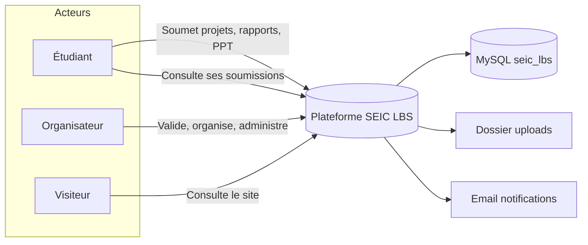

---

## 2. Diagramme global des cas d'utilisation

```mermaid
flowchart TB
    subgraph Commun
        UC00[UC00 Se connecter]
        UC01[UC01 S'inscrire]
        UC02[UC02 Se déconnecter]
    end

    subgraph Organisateur
        UC10[UC10 Gérer les éditions]
        UC11[UC11 Gérer les projets]
        UC12[UC12 Valider les rapports]
        UC13[UC13 Valider les présentations]
        UC14[UC14 Gérer groupes et salles]
        UC15[UC15 Consulter projets par édition]
        UC16[UC16 Importer PDF]
        UC17[UC17 Exporter une édition ZIP]
    end

    subgraph Étudiant
        UC20[UC20 Soumettre un projet]
        UC21[UC21 Soumettre un rapport PDF]
        UC22[UC22 Soumettre une présentation]
        UC23[UC23 Suivre ses soumissions]
        UC24[UC24 Consulter les projets]
    end

    subgraph Visiteur
        UC30[UC30 Consulter l'accueil]
        UC31[UC31 Consulter les projets publics]
        UC32[UC32 Laisser un commentaire]
    end

    O((Organisateur)) --- UC10 & UC11 & UC12 & UC13 & UC14 & UC15 & UC16 & UC17
    E((Étudiant)) --- UC20 & UC21 & UC22 & UC23 & UC24
    V((Visiteur)) --- UC30 & UC31 & UC32
    O & E & V --- UC00 & UC01 & UC02
```

---

## 3. Cas d'utilisation détaillés

### 3.1 Organisateur

| ID | Cas d'utilisation | Préconditions | Postconditions |
|----|-------------------|---------------|----------------|
| UC10 | Gérer les éditions | Connecté, rôle organisateur | Édition créée/modifiée/supprimée |
| UC11 | Gérer les projets | Connecté, rôle organisateur | Projet enregistré en BDD |
| UC12 | Valider les rapports | Rapport en attente | État `valide` ou `refuse` + commentaire |
| UC13 | Valider les présentations | Présentation en attente | État mis à jour |
| UC14 | Gérer groupes et salles | Connecté, rôle organisateur | Attribution groupe/salle |
| UC15 | Projets par édition | Édition existante | Liste filtrée affichée |
| UC16 | Importer PDF | Fichier PDF valide | Rapport enregistré |
| UC17 | Exporter ZIP | Édition sélectionnée | Archive téléchargée |

### 3.2 Étudiant

| ID | Cas d'utilisation | Préconditions | Postconditions |
|----|-------------------|---------------|----------------|
| UC20 | Soumettre un projet | Connecté, rôle étudiant | Projet créé |
| UC21 | Soumettre un rapport | Projet existant, PDF | Rapport `en_attente` |
| UC22 | Soumettre présentation | Projet existant, PPT | Présentation `en_attente` |
| UC23 | Suivi soumissions | Au moins une soumission | Statuts affichés |
| UC24 | Consulter projets | Connecté | Liste + commentaires visibles |

### 3.3 Visiteur

| ID | Cas d'utilisation | Préconditions | Postconditions |
|----|-------------------|---------------|----------------|
| UC30 | Consulter l'accueil | Aucune | Page index affichée |
| UC31 | Consulter projets | Compte visiteur ou accès public | Projets listés |
| UC32 | Laisser commentaire | Connecté visiteur, projet ouvert | Commentaire en BDD |

### 3.4 Commun

| ID | Cas d'utilisation | Acteurs | Résultat |
|----|-------------------|---------|----------|
| UC00 | Se connecter | Tous | Session ouverte, redirection dashboard |
| UC01 | S'inscrire | Étudiant, Visiteur | Compte créé, hash bcrypt |
| UC02 | Se déconnecter | Tous connectés | Session détruite |

---

## 4. Diagrammes de séquence

### UC00 — Se connecter

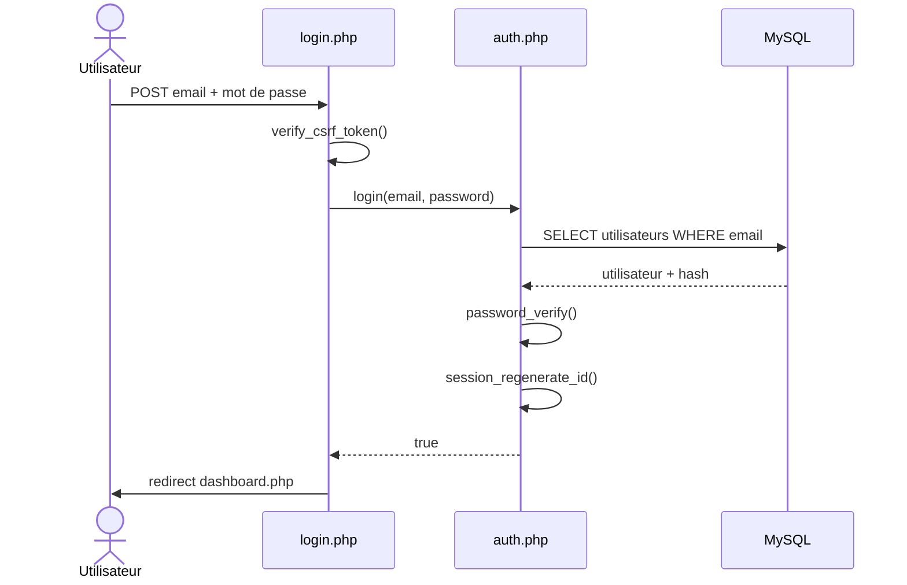

### UC12 — Valider un rapport (Organisateur)

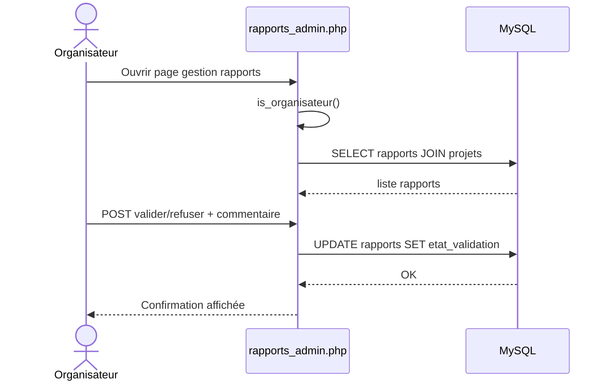

### UC21 — Soumettre un rapport (Étudiant)

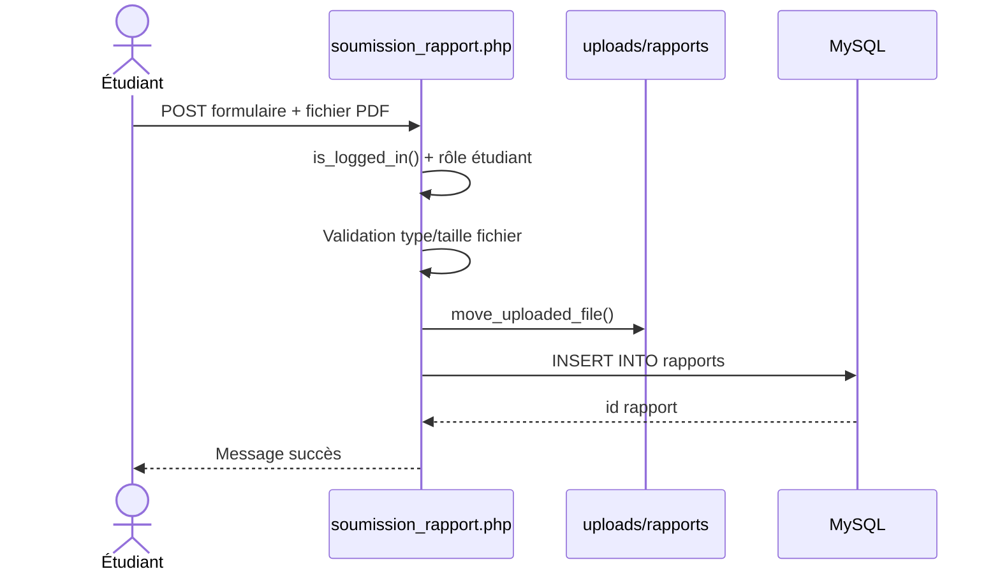

### UC32 — Laisser un commentaire (Visiteur inscrit)

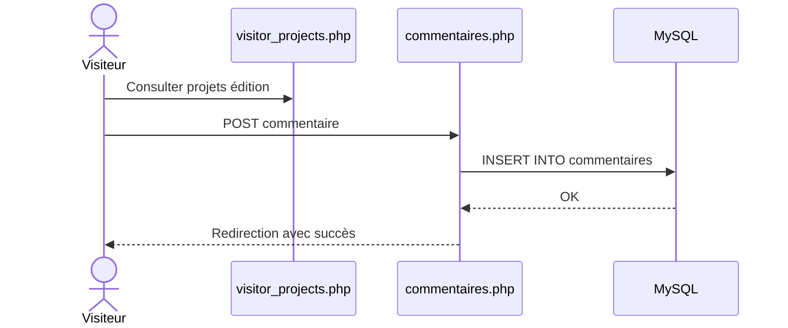

---

## 5. Diagrammes d'activité

### UC00 — Connexion

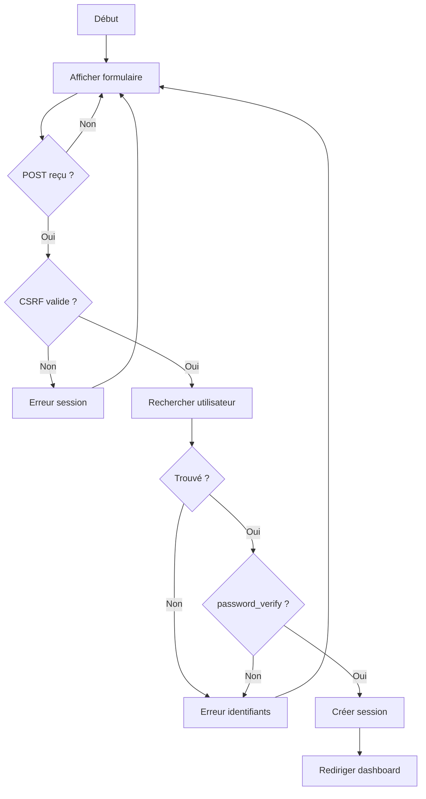

### UC12 — Validation rapport

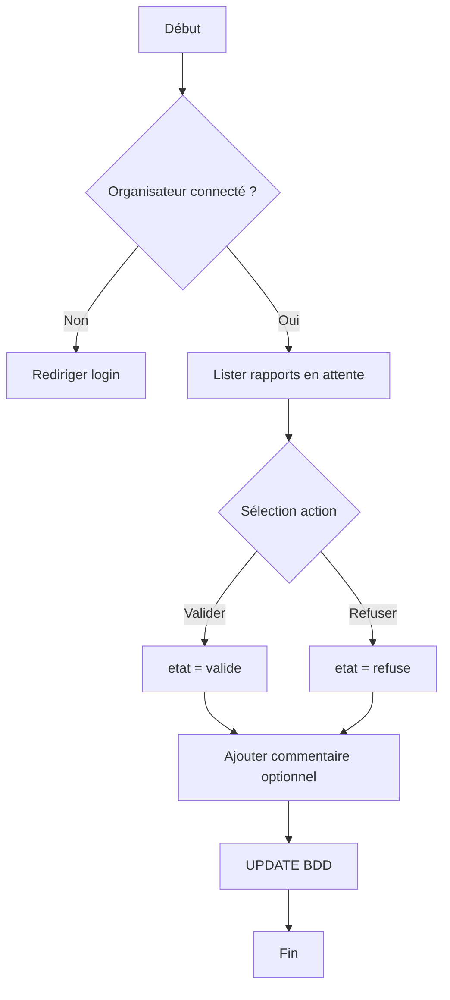

### UC21 — Soumission rapport PDF

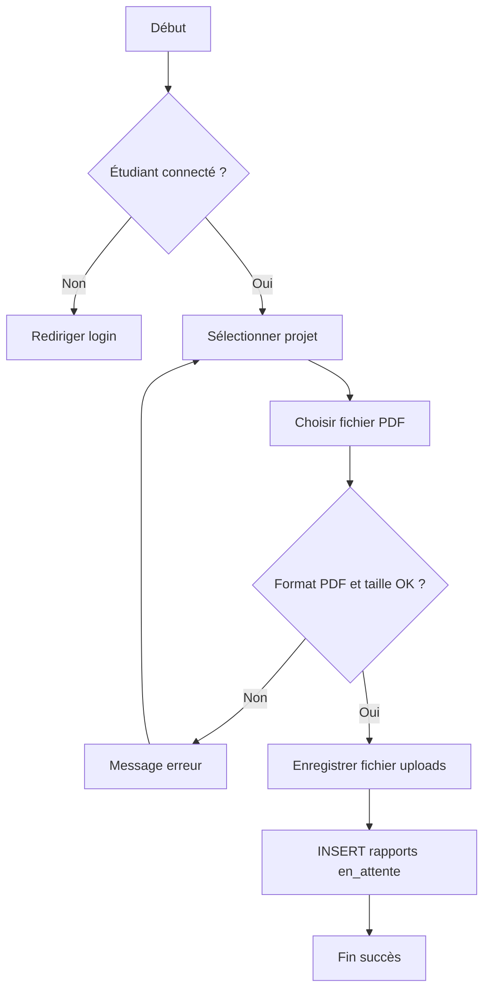

---

## 6. Diagramme de classes

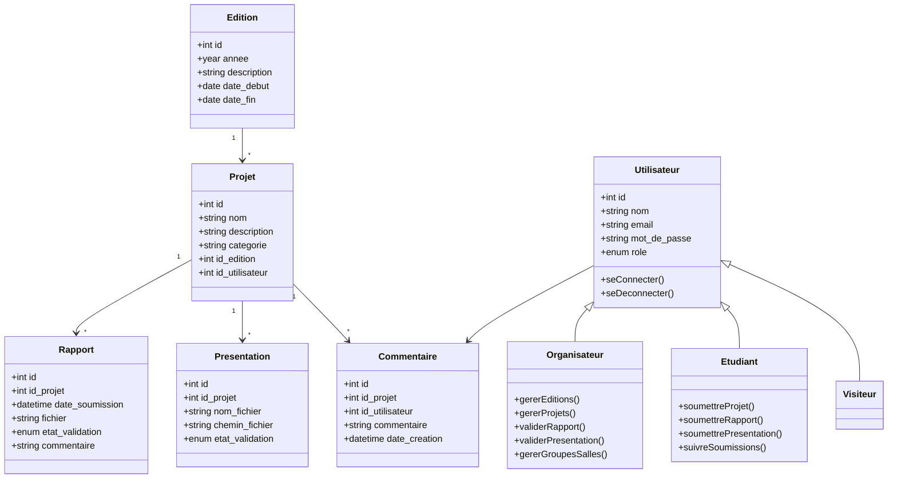

---

## 7. Diagramme de déploiement

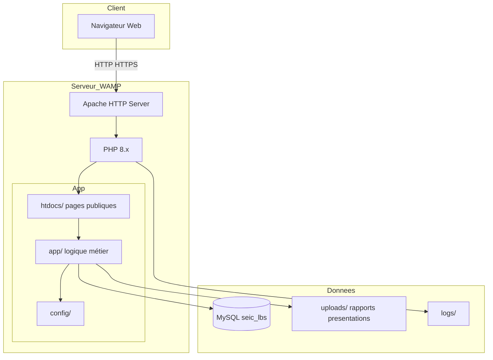

---

## Correspondance code ↔ cas d'utilisation

| UC | Fichier(s) principal(aux) |
|----|---------------------------|
| UC00 | `htdocs/login.php`, `app/auth.php` |
| UC01 | `htdocs/register.php` |
| UC02 | `htdocs/logout.php` |
| UC10 | `htdocs/editions.php`, `app/editions.php` |
| UC11 | `htdocs/projets.php`, `app/projets.php` |
| UC12 | `htdocs/rapports_admin.php`, `app/rapports_admin.php` |
| UC13 | `htdocs/gestion_powerpoint.php` |
| UC14 | `htdocs/groupes_salles.php` |
| UC15 | `htdocs/projets_edition.php` |
| UC16 | `htdocs/import_pdf.php` |
| UC17 | `htdocs/export_zip.php` |
| UC20–22 | `htdocs/soumettre_*.php` |
| UC23 | `htdocs/suivi_soumissions.php` |
| UC24 | `htdocs/etudiant_projets.php` |
| UC30 | `htdocs/index.php` |
| UC31–32 | `htdocs/visitor_projects.php` |

---

**Auteur :** Khalil — Projet SEIC LBS, Lomé Business School
